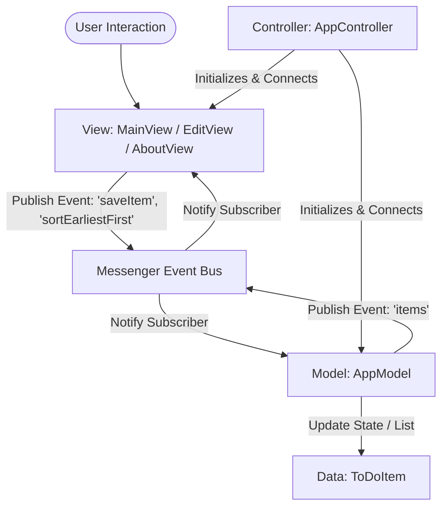
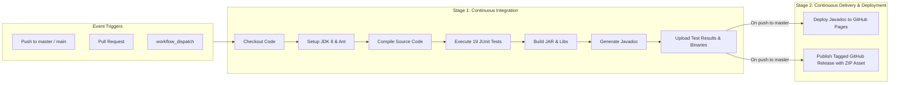

# 📝 ToDoList - Java Swing Desktop Application & CI/CD Pipeline

[](https://github.com/sadvikauppala/ToDoList/actions/workflows/ci-cd.yml)
[](https://opensource.org/licenses/MIT)
[](https://www.oracle.com/java/)
[](https://ant.apache.org/)

A full-featured Java Swing desktop application implementing an interactive To-Do List manager with support for task creation, editing, status tracking, date scheduling, and multi-criteria sorting. 

This repository is equipped with a complete, production-grade **CI/CD (Continuous Integration & Continuous Deployment) pipeline** built with **GitHub Actions**.

---

## 📑 Table of Contents
1. [Project Overview & Purpose](#-project-overview--purpose)
2. [Architecture & Design Patterns](#-architecture--design-patterns)
3. [Folder Structure](#-folder-structure)
4. [Technologies & Dependencies](#-technologies--dependencies)
5. [Local Setup, Build & Execution](#-local-setup-build--execution)
6. [CI/CD Pipeline Implementation](#-cicd-pipeline-implementation)
   - [Pipeline Overview](#pipeline-overview)
   - [Stage-by-Stage Explanation](#stage-by-stage-explanation)
   - [Automated Deployment](#automated-deployment)
7. [Testing Strategy](#-testing-strategy)
8. [License](#-license)

---

## 🎯 Project Overview & Purpose

**ToDoList** is a Java-based desktop productivity application originally designed for AP Computer Science curricula to demonstrate object-oriented programming, data structures, and the **Model-View-Controller (MVC)** architectural pattern.

### Key Features
- **Task Management**: Create, edit, and delete to-do items.
- **Completion Tracking**: Toggle completion status directly via interactive table checkboxes.
- **Due Date Scheduling**: Attach dates to tasks with custom calendar datepicker controls (`JXDatePicker`).
- **Date-based Sorting**: Sort tasks chronologically (**Earliest First** or **Latest First**), handling null dates gracefully.
- **Bulk Cleanup**: Remove all completed items with a single click.

---

## 🏗️ Architecture & Design Patterns

The codebase strictly follows the **Model-View-Controller (MVC)** design pattern, coupled with an **Event-Driven Publish/Subscribe (Messenger)** bus to decouple UI components from data models:



- **Model (`AppModel`)**: Holds the collection of `ToDoItem` objects, handles sorting algorithms, CRUD operations, and message subscriptions.
- **View (`MainView`, `EditView`, `AboutView`)**: NetBeans GUI Form-generated Swing views providing the visual user interface and rendering custom table cells.
- **Controller (`AppController`)**: Bootstraps the application, wires the messenger, model, and views together.
- **Event Bus (`Messenger`)**: Publishes messages asynchronously and synchronously between components, keeping views completely decoupled from the data storage layer.

---

## 📁 Folder Structure

```text
ToDoList/
├── .github/
│   └── workflows/
│       └── ci-cd.yml          # GitHub Actions CI/CD pipeline definition
├── assets/
│   └── todo.jpg               # Application splash screen / media assets
├── build.ps1                  # Cross-platform Windows local build & test script
├── build.sh                   # Linux/macOS local build & test script
├── build.xml                  # Apache Ant build script (NetBeans root)
├── json/                      # JSON data storage directory
├── lib/                       # Bundled third-party libraries & dependencies
│   ├── beans-binding/         # Beans Binding 1.2.1 library
│   ├── CopyLibs/              # NetBeans CopyLibs ant task
│   ├── junit/                 # JUnit 3.8.2
│   ├── junit_4/               # JUnit 4.10 test framework
│   ├── messenger.jar          # Event messenger library
│   ├── swingx-all-1.6.4.jar   # SwingX extended Swing controls (e.g., JXDatePicker)
│   └── nblibraries.properties # Ant library path mappings
├── nbproject/                 # NetBeans project configuration
│   ├── build-impl.xml         # Generated Ant build implementation
│   ├── project.properties     # Compiler and runtime properties
│   └── project.xml            # NetBeans project metadata
├── run.ps1                    # Launch application on Windows
├── run.sh                     # Launch application on Linux/macOS
├── src/                       # Java source code
│   └── com/mrjaffesclass/apcs/todolist/
│       ├── AboutView.java     # About dialog UI
│       ├── AppController.java # Application main entry point
│       ├── AppModel.java      # Application state and business logic
│       ├── EditView.java      # Add / Edit item dialog
│       ├── MainView.java      # Primary table view and controls
│       └── ToDoItem.java      # Data model for individual to-do items
├── test/                      # Automated unit test suite
│   └── com/mrjaffesclass/apcs/todolist/
│       ├── AppModelTest.java  # Unit tests for AppModel
│       └── ToDoItemTest.java  # Unit tests for ToDoItem
└── README.md                  # Project documentation & CI/CD guide
```

---

## 🛠️ Technologies & Dependencies

| Technology | Purpose |
| :--- | :--- |
| **Java (JDK 8+)** | Core programming language |
| **Java Swing & AWT** | Desktop Graphical User Interface |
| **SwingX 1.6.4** | Advanced UI components (`JXDatePicker` calendar picker) |
| **Beans Binding 1.2.1** | Synchronizes UI elements with data model properties |
| **Messenger** | Lightweight publish-subscribe messaging library |
| **JUnit 4.10** | Automated unit testing framework |
| **Apache Ant** | Declarative build and packaging tool |
| **GitHub Actions** | Automated CI/CD workflow automation |

---

## 💻 Local Setup, Build & Execution

### Prerequisites
- **JDK 8 or newer** installed (`java -version`, `javac -version`).
- (Optional) **Apache Ant** installed if building via Ant directly.

### Option A: Using Local Scripts (Recommended - No Ant or NetBeans needed!)

#### On Windows (PowerShell):
```powershell
# Build, run unit tests, and package executable JAR:
.\build.ps1

# Launch the GUI application:
.\run.ps1
```

#### On Linux / macOS (Bash):
```bash
# Make scripts executable:
chmod +x build.sh run.sh

# Build, run unit tests, and package executable JAR:
./build.sh

# Launch the GUI application:
./run.sh
```

### Option B: Using Apache Ant
```bash
# Clean, compile, run tests, and generate JAR + Javadoc:
ant -Djava.awt.headless=true clean compile test jar javadoc

# Run the packaged application:
java -jar dist/ToDoList.jar
```

---

## 🚀 CI/CD Pipeline Implementation

The CI/CD pipeline is defined in [`.github/workflows/ci-cd.yml`](.github/workflows/ci-cd.yml) using **GitHub Actions**.

### Pipeline Architecture



### Stage-by-Stage Explanation

#### 1. Triggers
- **`push` to `master` or `main`**: Runs the complete CI pipeline and triggers automated deployments.
- **`pull_request` to `master` or `main`**: Runs the CI validation (compile, test, and package) to prevent broken code from being merged.
- **`workflow_dispatch`**: Enables manual trigger from the GitHub web UI for ad-hoc validation.

#### 2. Stage 1: Build & Test (`build-and-test` Job)
- **`actions/checkout@v4`**: Checks out the repository files onto the runner.
- **`actions/setup-java@v4`**: Configures Eclipse Temurin JDK 8 for maximum backwards and forwards compatibility.
- **`Install Ant & Ant-Optional`**: Installs Apache Ant along with the optional JUnit task extension (`ant-optional`) to ensure JUnit test reporting works out of the box.
- **`ant clean compile`**: Cleans the build directory and compiles all Java classes.
- **`ant test`**: Executes all 19 unit tests headlessly (`-Djava.awt.headless=true`). If any test fails, the pipeline immediately halts and marks the build as failed.
- **`ant jar`**: Invokes the NetBeans `CopyLibs` task to package `dist/ToDoList.jar` with manifest classpath and copy required libraries into `dist/lib/`.
- **`ant javadoc`**: Generates full HTML API documentation.
- **`actions/upload-artifact@v4`**: Persists test reports, compiled distribution, and Javadoc as downloadable GitHub Actions artifacts.

#### 3. Stage 2: Continuous Deployment (`deploy-pages` and `deploy-release` Jobs)
- **Automated GitHub Release**:
  - Automatically bundles the executable JAR, required libraries, and instructions into `ToDoList-v1.0.<run_number>.zip`.
  - Creates a GitHub Release tagged `v1.0.<run_number>` with release notes and attaches the standalone downloadable archive.
- **Automated GitHub Pages Documentation**:
  - Uploads the generated Javadoc HTML to GitHub Pages so documentation is hosted live on the web.

---

## 🧪 Testing Strategy

The project includes automated unit test suites covering the core model logic and item data manipulation:

1. **`ToDoItemTest`**:
   - Constructor field initialization.
   - Getter and setter integrity.
   - Task completion toggling (`toggleDone`).
   - Merge logic between items.

2. **`AppModelTest`**:
   - Model initialization and item registration.
   - CRUD operations (Get, Put, Delete items).
   - Date sorting algorithm (`sortByDate(true)` and `sortByDate(false)`).
   - Message notification event handling.

---

## 📄 License

This project is licensed under the MIT License - see the LICENSE file for details.
